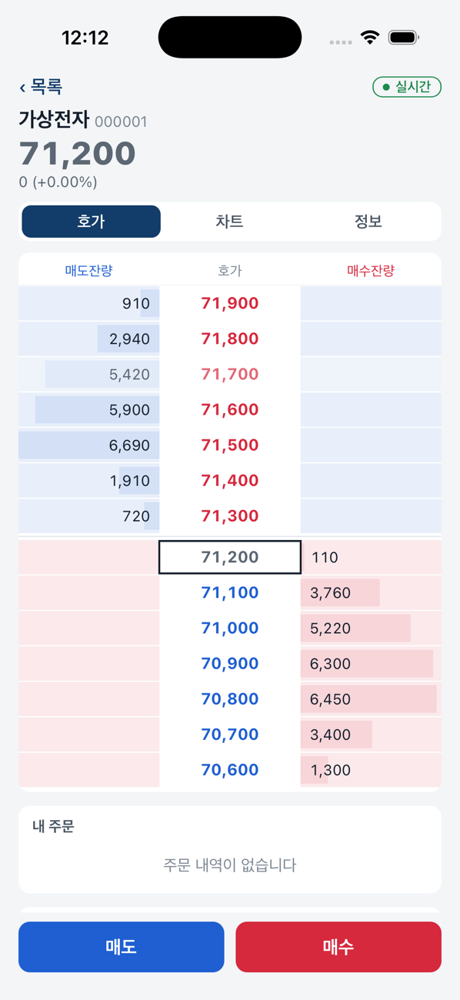
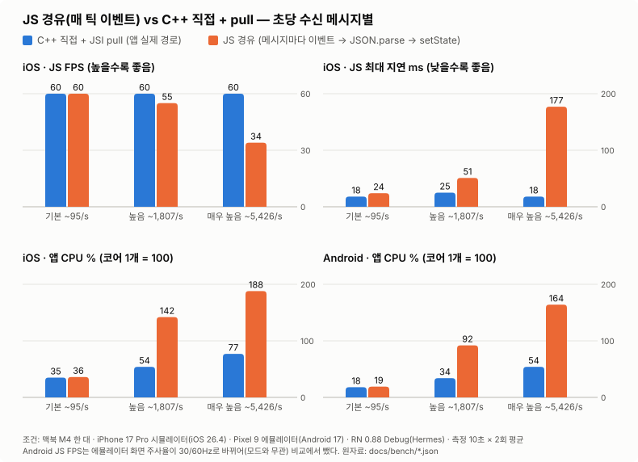

# Hoga — Mini MTS

C++ 엔진 하나를 **iOS · Android · Node 서버**가 함께 쓰는 작은 모바일 트레이딩 시스템(MTS) 개인 프로젝트입니다.
앱 셸은 React Native(New Architecture), 공용 로직은 C++20, 서버는 Node.js입니다.

> 모의 데이터만 사용합니다. 실제 증권사·거래소의 이름, 상표, 화면 디자인, 시세 데이터는 쓰지 않습니다.

## 진행 상황

| 단계 | 내용 | 상태 |
|---|---|---|
| M0 | 같은 C++ 함수를 C++ · Node · iOS · Android에서 호출 | 완료 |
| M1 | C++ 호가·재동기화·주문 검증·매칭 엔진 + Node 모의 거래소 서버 | 완료 |
| M2 | 앱 실시간 호가 (C++ TurboModule + 플랫폼 소켓, JNI · Obj-C++) | 완료 |
| M3 | 로그인 · 주문 · 체결 알림 · 보안 저장소 · 기기 보안 신호 | 완료 |
| M4 | Fabric 네이티브 캔들 차트 (iOS CoreGraphics / Android Canvas) | 완료 |
| M5 | 웹 화면(HTML/JS·AngularJS) + 웹뷰 브리지 · AngularJS 관리 콘솔 · 분석 이벤트 분류표 · ko/en/id/th 현지화 | 완료 |
| M6 | Jenkins 병렬 파이프라인 · Appium 두 플랫폼 E2E · k6 부하·장애 · "JS 경유 vs C++ 직접" 비교 실험 | 완료 |
| **M7** | Redis로 gateway 여러 대 · 이진 시세 프로토콜 · 주문 OTP · 자체 릴리스 도구 hoga-cli | **완료** |

### M7 요약

| 주제 | 한 일 | 숫자 · 결과 |
|---|---|---|
| gateway 여러 대 | `ROLE=market`(시세 단일 작성자·주문·인증) + `ROLE=gateway`×N(웹소켓만, 상태 없음) + Redis Pub/Sub + nginx(`least_conn`). gateway는 market 호가를 복제해 구독 즉시 스냅샷을 준다. 멱등 키·리프레시 토큰·OTP는 Redis | 3,000명 접속 중 **gateway 1대 강제 종료(SIGKILL)** → 끊긴 999명만 다른 gateway로 재접속, 연결 성공 100%, 복구 p99 **0.76초**·최대 0.9초. 나머지 2/3는 영향 없음. market을 재시작해도 멱등 키·로그인 유지 |
| 이진 시세 | `hoga::wire` v1(LEB128 가변 정수) C++ 코덱 + TS 인코더, 두 구현을 `shared/protocol/wire-v1.json` 골든 벡터로 서로 시험. `/ws?proto=bin`, 앱 기본값으로 채택(주문 알림·오류는 JSON 유지) | 메시지 89→21바이트(**−77%**), 3,000명 대역폭 7.1→2.1MB/s(**−71%**), 앱 C++ 수신 처리 1,133→78ns(**14.5배**), 서버 CPU는 같음 |
| 주문 OTP | RFC 6238 TOTP(±30초, 같은 코드 재사용 금지, 5번 틀리면 5분 잠금), 시드 AES-256-GCM 암호화 저장, 주문은 10분짜리 step-up 토큰 필요. 설정에서 QR 등록, 주문 중 403이면 코드 입력 → 같은 멱등 키로 재전송. 관리 콘솔 API에 OTP 초기화 | RFC 테스트 벡터 통과, 화면의 QR을 CoreImage로 읽어 `otpauth://` 확인, iOS·Android E2E에서 시험이 인증 앱 역할을 해 주문까지 |
| hoga-cli | `hoga status / version / changelog / release`: 4곳에 흩어진 앱 버전(package.json·version.ts·build.gradle·pbxproj) 일치, Conventional Commits 변경 로그, Android AAB·iOS 아카이브(서명 없음), 요약 JSON, Slack 웹훅(설정 시) | 0.0.1 / 1.0 / 0.5.0으로 어긋나 있던 버전을 0.7.0으로 맞춤. 릴리스 1회: AAB 31.8MB, iOS .app 79MB(JS 번들 포함) |



화면: [OTP 등록(QR)](docs/m7-ios-otp-enroll.png) · [주문 중 OTP 입력](docs/m7-ios-order-otp.png) · [인증 후 전량 체결](docs/m7-ios-order-otp-filled.png) · [클러스터 경유 호가(이진)](docs/m7-ios-quote-cluster-binary.png)

### M7 검증 결과 (2026-11-16)

| 대상 | 내용 | 결과 |
|---|---|---|
| C++ | `wire` 코덱(골든 벡터·잘린 입력·2^53 초과·단계 수 폭탄·끝없는 varint 거부, JSON 변환), MarketClient 이진 수신 (코어 77개, +6) | 일반 · ASan · TSan 통과 (ASan이 시험 코드의 dangling 참조를 잡아 고침) |
| 서버 | Redis 클러스터 시험(market 1 + gateway 2를 실제 Redis로: 같은 변경분 순서, 복제 스냅샷 = market, 사용자 알림 라우팅, 관리 끊기 전파, 재시작 후 멱등 키·토큰 유지, 동시 토큰 회전 하나만 성공), TOTP RFC 벡터, OTP 잠금·암호화·step-up, 이진 골든 벡터, `?proto=bin` (vitest 68개, +25) | 통과 |
| 앱 | OTP 상태 머신(재전송·취소·횟수 제한), 주문 중 OTP 흐름·설정 등록 화면 (Jest 46개, +5) | 통과 |
| hoga-cli | semver·Conventional Commits·변경 로그·버전 파일 4종 쓰기(임시 저장소·git) (node:test 7개) | 통과 |
| Appium E2E | 기존 4개 + **OTP 주문**(시험이 TOTP 계산), 클러스터(nginx → gateway 3대)에 붙여 | iOS 5/5 · Android 5/5 |
| Jenkins | Tools 단계(hoga-cli 시험·버전 일치) 추가, C++ 단계에서 이진 벤치 결과 보관 | **#4 성공 10분 50초**, JUnit **370개 통과 · 실패 0** (C++ 77×3 · 서버 68 · 앱 46 · N-API 8 · hoga-cli 7 · E2E 5×2). #3은 iOS·Android 빌드와 겹쳐 M1의 느린 클라이언트 시험이 5초를 넘김 → 건너뛰기가 시작되면 부하 생성을 멈추게 고침 |

### M7에서 찾은 것들

- **맥 한 대에서는 nginx를 거치면 1만 연결 전에 임시 포트가 바닥난다.** 연결마다 k6→nginx, nginx→gateway 두 개의 임시 포트(49152–65535, 약 1.6만 개)를 쓰고, 끊긴 연결의 TIME_WAIT까지 겹쳐 gateway의 Redis 재연결까지 `EADDRNOTAVAIL`로 실패했다. 부하 측정은 k6가 gateway 포트로 직접 나눠 붙고(L4·DNS 분산과 같은 모양), nginx는 앱·기능 시험용으로 둔다. 포트 범위는 시스템 설정이라 바꾸지 않았다.
- **gateway를 늘려도 이 맥에서는 5,000명이 한계.** 3대에서도 초당 메시지는 9.2만→12.2만으로 늘었지만 1만 명에서는 연결이 8초 SYN 재전송으로 멈췄다(CPU는 남음 → OS accept 대기열 `somaxconn` 128). 더 재려면 기계가 여러 대 필요하다.
- **단일 프로세스의 "전달 지연"은 과소평가였다.** 같은 3,000명에서 클러스터 p95가 24→151ms로 늘어 구간을 나눠 쟀다: Redis 구간은 한가할 때 1ms, gateway가 받은 시세의 지연(`/healthz`의 `busLagMs`) p50 42ms · p99 156ms. 단일 프로세스는 market이 한 메시지를 다 보낸 뒤에야 다음 메시지 시각을 찍어 대기 시간이 숨었고, 클러스터는 시각을 먼저 찍어 그대로 드러난다. gateway 1대로 줄여도 같아 대수 문제는 아니다.
- **주문 OTP 화면은 키보드에 가려졌다.** iOS 숫자 키패드에는 Return 키가 없어 확인 버튼이 가려지면 진행할 수 없었고, Android는 `Modal`이 별도 창이라 adjustResize가 안 먹어 입력칸까지 가려졌다(E2E가 잡음). `KeyboardAvoidingView`(두 플랫폼 padding) + 6자리가 차면 자동 확인으로 고쳤고, OTP를 기다리는 동안 원래 주문 버튼을 막아 같은 주문이 두 번 시작되지 않게 했다. 설정 화면은 입력 중 버튼이 첫 탭에 안 눌려 `keyboardShouldPersistTaps="handled"`.
- **종료 순서 버그**: Redis를 먼저 끄면 gateway의 `quit()`가 재연결을 기다리며 끝나지 않았다 → 1초 뒤 강제 끊기 + 프로세스 10초 종료 시한, 클러스터 스크립트는 gateway → market → Redis 순서로.
- **로컬 Maven 미러에는 디버그 aar만 있어** 릴리스 AAB가 실패 → hoga-cli는 미러에 릴리스 aar가 있을 때만(`RN_MAVEN_MIRROR`) 쓴다.

### M6 비교 실험 — 고빈도 시세를 JS로 보내면 무엇이 무너지나



같은 호가 표(매도 10 + 매수 10)를 두 경로로 그리고, 서버 시세 속도를 세 단계로 올리며 10초씩 두 번 쟀습니다. 측정은 Appium이 자동으로 합니다(`e2e/specs/bench.e2e.ts`, 원자료 `docs/bench/*.json`).

| 경로 | 하는 일 |
|---|---|
| **C++ 직접 + pull** (앱 실제 경로) | 소켓 → C++ `MarketClient`가 장부 유지 → JS는 초당 12번 `getBook`(JSI 동기 호출) |
| **JS 경유** (비교용으로 일부러 만든 경로) | 소켓 → C++ → 메시지마다 TurboModule 이벤트 → `JSON.parse` → JS 장부 → `setState` |

| 초당 수신 메시지 | iOS JS FPS (C++ / JS) | iOS JS 최대 지연 ms | iOS 앱 CPU % | Android 앱 CPU % |
|---|---|---|---|---|
| 약 95 | 60 / 60 | 18 / 24 | 35 / 36 | 18 / 19 |
| 약 1,800 | 60 / 55 | 25 / 51 | 54 / **142** | 34 / **92** |
| 약 5,400 | 60 / **34** | 18 / **177** | 77 / **188** | 54 / **164** |

- 평소 속도에서는 차이가 없습니다. **초당 수천 건이 되면 JS 경유 쪽만 무너집니다**: iOS JS FPS 60 → 34, 버튼 반응에 해당하는 JS 지연 최대 177ms, CPU는 코어 2개 가까이. C++ 경로는 메시지가 57배 늘어도 JS FPS·지연이 그대로이고, 렌더도 초당 12번으로 고정입니다(JS 경유는 초당 180~190번).
- "JS 지연"은 50ms 타이머가 늦게 불린 정도입니다. 버튼을 눌렀을 때 `onPress`가 기다리는 시간과 성질이 같습니다. 타이머가 화면 주기에 맞춰 불려 한가할 때도 12~17ms가 나옵니다.
- CPU는 호스트에서 잰 앱 프로세스의 누적 CPU 시간 ÷ 경과 시간(100% = 코어 1개)입니다. 앱 화면 쪽 숫자(JS FPS·지연·렌더·메시지 수)는 앱이 testID로 화면에 내보내고 Appium이 읽습니다.
- **Android JS FPS는 비교에서 뺐습니다.** 에뮬레이터 화면이 60/30/20Hz를 오가며(`dumpsys display`) 두 모드 모두 30 근처가 나와 경로의 차이가 아니라 화면 주사율을 잽니다. Android는 CPU와 렌더 횟수로 비교합니다.
- 조건: 맥북 M4(10코어) 한 대, iPhone 17 Pro 시뮬레이터(iOS 26.4), Pixel 9 에뮬레이터(Android 17), RN 0.88 **Debug** 빌드(Hermes). Release·실기기 숫자는 다릅니다.
- 앱에서 직접 보기: 설정 → "성능 실험", 관리 콘솔에서 주기 10ms · 주기당 횟수를 올린 뒤 두 모드를 각각 측정. [iOS 화면(JS 경유, 초당 5,400건)](docs/m6-ios-bench-js.png)

### M6 검증 결과 (2026-11-16)

| 대상 | 내용 | 결과 |
|---|---|---|
| Jenkins | `Jenkinsfile`: Prepare → C++(일반·ASan·TSan) · 서버 · 앱 JS · iOS · Android **병렬** → Appium E2E iOS · Android **병렬** → (선택) 비교 실험 · k6. JUnit 리포트·APK 보관 | **#2 성공 5분 22초**: 빌드·단위 단계 병렬(가장 긴 iOS 66초), E2E iOS 122초 · Android 99초 동시, k6 104초. JUnit **313개 통과 · 실패 0** (C++ 71×3 · 서버 43 · 앱 41 · N-API 8 · E2E 4×2). #1은 iOS·Android 빌드와 동시에 돈 앱 Jest가 5초 제한을 넘겨 실패 → 화면 흐름 시험 제한 30초 · Jest 작업자 2개로 고침 |
| Appium E2E | WebdriverIO 테스트 **한 벌**을 capability만 바꿔 두 플랫폼에서 실행. ① 로그인 → 호가 → 주문 → 결과 ② 서버 응답 5초 지연 → "확인 중" → 조회로 확정 ③ seq 누락 20% 주입 → 재동기화 횟수 증가 ④ 웹뷰 종목정보의 매수 → 네이티브 주문 창(웹은 주문을 내지 않음) | iOS 4/4 · Android 4/4 |
| k6 주문 | 초당 200건 × 60초, 10%는 같은 멱등 키로 재전송 | 새 주문 10,906 · 재전송 1,094 → **서버가 만든 주문 10,906(중복 0)**, 재전송 응답 orderId 불일치 0, p99 1.1ms |
| k6 시세 팬아웃 | 0 → N명 접속 후 유지, 1인당 종목 1~3개 | 아래 표 |
| k6 연결 끊기 | 5,000명 유지 중 관리 API로 전부 끊기(1012) → 재접속 | 개선 전후 아래 표 |
| C++ | `MarketClient` 시세 원문 탭(잠금 밖 호출) · 재접속 창 읽기·적용 (코어 71개, +3) | 일반 · ASan · TSan 통과 |
| 서버 · 앱 | 시세 속도 조절(`simBurst`) · 재접속 창 계산·전송 (vitest 43개), JS 장부·측정기·실험 화면 흐름 (Jest 41개) | 통과 |

**시세 팬아웃** (k6와 서버를 같은 맥에서 실행, 서버 기본 시세 속도)

| 동시 접속 | 연결 성공 | 초당 전달 메시지 | 전달 지연 p95 / p99 |
|---|---|---|---|
| 1,000 | 100% | 28,600 | 6 / 14 ms |
| 3,000 | 100% | 83,600 | 24 / 51 ms |
| 5,000 | 100% | 92,200 | 44 / 106 ms |
| 10,000 | **8.7%** | 49,800 | 381 / 4,180 ms |

→ 이 맥 한 대에서는 **5,000명까지 안정, 10,000명에서 무너집니다.** 이때 k6가 코어 4개 이상을 써서 부하 발생기도 한계입니다(처음엔 k6가 메시지마다 `JSON.parse`해서 5,000명에서 먼저 무너졌고, 20개 중 1개만 파싱하게 고쳐 서버 쪽 한계를 보이게 했습니다). 전달 지연 = 서버가 메시지에 찍은 시각 ↔ 받은 시각(같은 기계라 시계가 같음).

### M6에서 찾은 문제 — 5,000명이 한꺼번에 재접속하면

| 5,000명 강제 끊기 후 | 연결 성공 | 실패한 연결 시도 | 복구 시간 중앙값 / p95 / p99 |
|---|---|---|---|
| 개선 전: 모두 0~0.5초 안에 재접속 | 87.3% | 1,436 | 0.5 / 23.1 / 28.5 s |
| 재접속 창 5초(초당 1,000명) | 86.3% | 1,566 | 2.6 / 28.9 / 30.8 s |
| **재접속 창 17초(초당 300명, 기본값)** | **99.5%** | **47** | 8.3 / 20.7 / 23.4 s |

- **원인**: 모두가 0.5초 안에 다시 붙으면 OS의 accept 대기열(`somaxconn` 128)이 가득 차고(`netstat -L` 128/128), 연결이 `operation timed out`으로 실패합니다. Node 이벤트 루프가 초당 9만 건을 내보내느라 accept가 밀리기 때문입니다. 실패한 클라이언트는 지수 백오프에 걸려 30초 가까이 늦게 돌아옵니다.
- **개선**: 서버가 1012로 끊을 때 close reason에 **재접속 창**(`retry-window=<ms>` = 끊는 연결 수 ÷ 초당 받아들일 수)을 싣고, C++ `MarketClient`는 첫 재접속을 그 창 안에서 무작위로 고릅니다(이후 백오프도 창보다 좁히지 않음, 상한 30초, 1012일 때만). k6 클라이언트도 같은 규칙입니다.
- **감수한 것**: 중앙값은 0.5초 → 8초로 늘었습니다. 대신 "대부분 빨리 + 일부는 30초"가 "모두 창 안에서 고르게"로 바뀌어 실패가 1,436 → 47번으로 줄었습니다. 초당 300은 이 맥에서 잰 값이라 `WS_RECONNECT_ACCEPT_PER_SEC`로 바꿀 수 있고, 실제로는 gateway를 늘려 창을 줄입니다.


### M5 검증 결과 (2026-11-15)

| 대상 | 내용 | 결과 |
|---|---|---|
| 서버 | 웹 화면 CSP(인라인 스크립트·eval 없음, GTM 설정 시에만 GTM 허용) · AngularJS는 min 파일만 공개 · 번역 버전/ETag 304 · 종목정보·공지(언어별, 없으면 ko) · 관리 API(토큰, 입력 검증, 주문 지연이 실제 응답에 반영, 변동성, 전체 연결 끊기 1012) (vitest 41개, 이번에 +11) | 통과 |
| 앱 | 브리지 거절 규칙 12종(출처·유사 호스트·버전·형식·크기 등) · 앱→웹 스크립트 주입 방지 · 속도 제한 · 번역 키/자리표시자 일치 · 서버 번역 덮어쓰기/304/실패 시 내장본 · 분류표 검사(웹 JS가 보내는 이벤트까지) · 화면 흐름 2개(웹 → 네이티브 주문 창, 인도네시아어 전환 시 `71.300`) (Jest 35개, 이번에 +26), `tsc` · ESLint | 통과 |
| iOS | 정보 탭 웹뷰(브리지 연결 → "앱에서 실시간 반영"), 웹 매수 → 네이티브 주문 창, 설정의 분석 이벤트 목록(🌐 = 웹에서 온 이벤트), 태국어 전환, 공지(AngularJS) 태국어·불기 연도 | [정보](docs/m5-ios-stock-info-web.png) · [웹→주문](docs/m5-ios-order-from-web.png) · [설정·분석](docs/m5-ios-settings-analytics.png) · [태국어](docs/m5-ios-watchlist-th.png) · [공지](docs/m5-ios-notices-th.png) |
| Android | 정보 탭 웹뷰 + 브리지, 웹 매도 → 네이티브 주문 창 | [정보](docs/m5-android-stock-info-web.png) · [웹→주문](docs/m5-android-order-from-web.png) |
| 관리 콘솔 | 브라우저에서 토큰 입력 → 실시간 지표·장애 주입. "연결 끊기" 후 앱이 스스로 재접속(Android 화면 `재연결 1`, 상태 `실시간`) | [콘솔](docs/m5-admin-console.jpg) |

### M5 설계 — 웹은 정보, 주문은 네이티브

```
                 서버(Fastify)                                   앱(RN)
  /web/stock/    순수 HTML·CSS·JS ─┐                      ┌─ HogaWebView (허용 출처만, 새 창·파일 접근 끔)
  /web/notices/  AngularJS 1.8    ─┼─ CSP: script-src 'self'│     │ 받은 메시지 검사: 크기 → 출처 → 속도 → 형식·버전
  /admin/        AngularJS 콘솔    ─┘                      │     ▼
  /i18n/:lang    shared/i18n (앱과 같은 파일)              │  hello → init(언어·테마) / unsupported
  /shared/analytics/events.json                            │  openOrder → 네이티브 주문 창(사용자가 직접 확인)
                                                           │  track → 분류표로 걸러 source=web
                    ◀── injectJavaScript(quote·locale) ────┘
```

- **웹은 주문을 직접 내지 못합니다.** `openOrder`는 앱의 주문 창을 여는 것뿐이고, 같은 종목일 때만 열리며 "웹에서 연 주문" 안내가 붙습니다. 가격·수량 검사는 기존 C++ 규칙 그대로입니다.
- **웹 메시지는 신뢰하지 않습니다.** 4KB 제한, 보낸 페이지 출처 확인(`http://localhost:8080.evil.example` 같은 유사 주소 포함), 초당 20개 제한, 타입별 필드 검사. 거절하면 `bridge_rejected` 이벤트로 남깁니다. 다른 주소로의 이동은 막고 외부 브라우저로도 넘기지 않습니다(피싱 경로 차단).
- **프로토콜 버전 협상**: 웹이 더 새 버전이면 앱이 `unsupported`로 답하고 웹 화면이 "앱 업데이트 필요"를 보여 줍니다. 웹은 앱보다 먼저 배포되기 때문입니다.
- **웹 화면은 앱 배포 없이 바뀝니다.** HTML은 `no-cache`, 번역은 서버 파일을 고치면 다음 요청부터 새 버전(ETag)이 나가고, 앱은 시작·언어 변경 때 받아 덮어씁니다(실패하면 내장 번역).
- **AngularJS는 `ng-csp` 모드**로 eval 없이 돌려 CSP를 지킵니다. 공지는 controller-as·서비스·필터·해시 라우팅(뒤로 가기), 관리 콘솔은 `$http` 인터셉터로 토큰을 붙이고 401이면 지웁니다.
- **분석은 분류표 한 벌**(`shared/analytics/events.json`, [문서](docs/analytics-taxonomy.md)). 웹뷰 안의 웹 이벤트는 앱 한 파이프라인으로만 보내 이중 집계를 막고, 일반 브라우저에서는 dataLayer → GTM(설정 시)으로 갑니다. Firebase·GA4·GTM 계정은 없어서 실제 전송은 하지 않고, 설정 화면의 디버그 목록으로 확인합니다.
- **현지화**: 번역 144개 키 × 4개 언어를 앱과 웹이 같이 씁니다. 숫자는 `Intl.NumberFormat`(인도네시아어 `71.200`), 날짜도 언어를 따릅니다(태국어는 불기 2569). 태국어는 성조 기호 때문에 줄 높이를 늘리고, 차트 안내 줄은 높이를 고정하지 않게 바꿨습니다. 세션 안내 문구는 번역 키로 저장해 언어를 바꾸면 따라 바뀝니다.

### M4 검증 결과 (2026-11-15)

| 대상 | 내용 | 결과 |
|---|---|---|
| C++ | `CandleSeries`(1분 봉·과거 병합·5분 집계) · `chart::layout`(보이는 구간·가격 범위·이동평균·격자·거래량·마지막가 선·십자선 인덱스) · `MarketClient`가 과거 봉+실시간 체결로 봉 생성 (코어 68개) | 일반 · ASan · TSan 통과 |
| Node · 서버 | `CandleSeries` N-API 바인딩 (8개), `GET /candles/:symbol?interval=1m\|5m\|15m` · 과거 봉 생성 · 잘못된 간격 400 (vitest 30개) | 통과 |
| 앱 | Jest 9개, `tsc` · ESLint | 통과 |
| iOS | 1분 · 5분 전환, 핀치 확대, 가로 드래그로 과거 보기 | [1분](docs/m4-ios-chart-1m.png) · [5분](docs/m4-ios-chart-5m.png) · [핀치](docs/m4-ios-chart-pinch.png) · [스크롤](docs/m4-ios-chart-scrolled.png) |
| Android | 1분 · 5분 전환, 길게 누르기 십자선 → `onCrosshair` 이벤트로 JS에 봉 정보 표시, 가로 드래그 | [1분](docs/m4-android-chart-1m.png) · [5분](docs/m4-android-chart-5m.png) · [십자선](docs/m4-android-crosshair.png) |

> Android 캡처는 `FLAG_SECURE` 때문에 `SECURE_SCREEN`(apps/mobile/src/config.ts)을 잠시 끄고 찍었습니다. 저장소에는 켜진 상태로 둡니다.

### M4 차트 설계 — 계산은 C++ 한 벌, 플랫폼은 그리기만

```
 체결(웹소켓) ─▶ MarketClient(C++) ─▶ CandleSeries ◀── GET /candles (과거 600봉)
                                         │
                       ChartDataSource (weak_ptr, 버전 번호)
                  ┌──────────────────────┴──────────────────────┐
     iOS HogaChartComponentView (Fabric)         Android HogaChartView (Fabric, 코드젠 ViewManager)
     CADisplayLink: 버전 바뀔 때만               Choreographer: 버전 바뀔 때만
     chart::layout() 직접 호출                   JNI nativeLayout() → double[] 한 번에
     CoreGraphics로 그리기                       Canvas로 그리기
```

- **봉 데이터는 JS를 거치지 않습니다.** 네이티브 뷰가 C++ 봉을 직접 읽고, JS는 종목·간격·이동평균 여부만 props로 넘깁니다. 십자선 정보만 이벤트로 JS에 올라갑니다.
- **배치 계산 공용**: 가격 범위, 격자 간격(호가단위에 맞춘 깔끔한 값), 이동평균, 마지막가 선과 겹치는 눈금 글자 제거까지 `hoga::chart::layout`이 계산하고 단위 테스트로 검증합니다. 두 플랫폼 화면이 같은 값을 보여 줍니다.
- **다시 그리기는 데이터가 바뀔 때만**: 화면 주기마다 버전 번호만 비교합니다. 버전에는 연결 세대를 섞어 재접속 뒤 같은 번호가 나와도 다시 그립니다.
- **JNI 왕복 1회**: Android는 한 프레임에 필요한 좌표를 `double[]` 하나로 받아 JNI 경계를 여러 번 넘지 않습니다.
- **5분·15분 봉은 저장하지 않고 1분 봉을 읽을 때 묶습니다.** 간격을 바꿔도 다시 받지 않습니다.
- 로그인 수정: Return 키가 마지막 입력 반영보다 먼저 와서 빈 비밀번호가 전송되던 문제를 ref로 고치고, 4xx 응답을 "서버에 연결할 수 없습니다"로 잘못 안내하던 문구를 바로잡았습니다. iOS 재설치 후 Keychain 세션 복원도 확인했습니다.

### M3 검증 결과 (2026-11-15)

| 대상 | 내용 | 결과 |
|---|---|---|
| 서버 | JWT·로그인 제한·리프레시 회전과 재사용 감지·사용자별 키 분리·남의 주문에 체결되면 나에게만 알림 (vitest 29개) | 통과 |
| C++ | `MarketClient` 인증·재연결 후 재인증·주문 이벤트 전달 (코어 49개) | 일반 · ASan · TSan 통과 |
| 앱 | 주문 상태 머신 8개(타임아웃 후 조회 확정·404면 같은 키 재전송·업무 거부·확인 불가 시 기록 유지·재시작 시 정리) + 화면 흐름 1개 | Jest 통과, `tsc`·ESLint 통과 |
| iOS | 로그인 → 즉시 체결 주문 → 대기 주문 → 다른 사용자 매도로 체결 알림 | [로그인](docs/m3-ios-login.png) · [주문 창](docs/m3-ios-order-sheet.png) · [체결](docs/m3-ios-order-filled.png) · [체결 알림](docs/m3-ios-fill-notification.png) |
| iOS + 응답 5초 지연 | 3초 타임아웃 → "확인 중" → 조회로 체결 확정. 서버에는 주문당 정확히 1건 | [확인 중](docs/m3-ios-order-confirming.png) |
| Android | 로그인 → 강제 종료 → 재실행 시 Keystore 토큰으로 세션 복원(`/auth/refresh` 200) | 서버 요청 로그 |
| Android `FLAG_SECURE` | 화면 캡처가 검게 나옴(민감 화면 보호 동작) | [캡처](docs/m3-android-flag-secure.png) |

### M2 검증 결과 (2026-11-15)

| 대상 | 내용 | 결과 |
|---|---|---|
| C++ `MarketClient` | 가짜 전송 계층으로 재연결·지터·재동기화·늦은 콜백 무시 등 10개 (코어 전체 47개) | 일반 · ASan+UBSan · TSan 통과 |
| JS | Jest(목 TurboModule로 연결·구독·호가 화면) · `tsc` · ESLint | 통과 |
| iOS 26.4 시뮬레이터 | 관심종목 · 실시간 호가 · 체결 | [목록](docs/m2-ios-watchlist.png) · [호가](docs/m2-ios-quote.png) |
| Android 17 에뮬레이터 | 같은 화면, 같은 C++ 코드 | [목록](docs/m2-android-watchlist.png) · [호가](docs/m2-android-quote.png) |
| 서버 종료(1012) | 두 앱 모두 "재연결 중"으로 바뀌고 끊긴 동안의 호가를 비움 → 서버 재시작 후 자동 복구 | [캡처](docs/m2-ios-reconnecting.png) |
| 변경분 5% 고의 누락 (`FAULT_DROP_SEQ_RATE=0.05`) | iOS 누락 감지 33 → 재동기화 33, Android 100 → 100. 화면은 계속 "실시간" | [iOS](docs/m2-ios-resync-stats.png) · [Android](docs/m2-android-resync-stats.png) |

### M1 검증 결과 (2026-11-15)

| 대상 | 내용 | 결과 |
|---|---|---|
| C++ 코어 | GoogleTest 37개 | 일반 · ASan+UBSan · TSan 빌드 모두 통과, `-Wconversion -Wshadow` 경고 없음 |
| Node 애드온 | node:test 7개 (매칭 엔진·검증 규칙을 C++에서 그대로 호출) | 통과 |
| 서버 | vitest 20개 (단위 + 실제 포트를 여는 통합 테스트) | 3회 연속 통과, `tsc` 통과 |
| 서버 실제 실행 | 2초 동안 2종목 구독 → 변경분 43개, seq 누락 0, SIGTERM 정상 종료 | 확인 |

### M3 주문 · 보안 설계

**주문 — "늦은 응답 = 실패"가 아니다**

```
 [보내기 전] 미확정 주문으로 보안 저장소에 먼저 기록(write-ahead)
 submitting ──200──────────────▶ 접수 / 업무 거부(OFF_TICK 등)
     ├─ 3초 타임아웃·네트워크 오류·5xx·409 ─▶ confirming ── GET /orders/:key
     │                                         ├─ 있음 ───▶ 접수 확정
     │                                         ├─ 처리 중 ─▶ 기다렸다 다시 조회
     │                                         └─ 없음 ───▶ 같은 Idempotency-Key로 재전송
     └─ 400·422 ─▶ 실패
 끝까지 모르면 "확인하지 못했습니다(다시 주문하지 마세요)" + 기록 유지 → 다음 로그인 때 조회로 정리
 (서버에 도착하지 않은 주문은 자동 재전송하지 않는다 — 사용자의 판단이 바뀌었을 수 있다)
```

- 주문 화면의 호가단위 이동·상하한가·검증은 서버와 같은 C++(`roundToTick`·`priceLimits`·`validateOrder`)를 TurboModule로 호출합니다. 멱등 키도 C++ `std::random_device` UUID입니다.
- 전송·확인 중에는 주문 버튼과 닫기가 잠겨 중복 주문이 불가능합니다.

**체결 알림 — 드문 것은 push, 잦은 것은 pull**

- 내 대기 주문이 다른 사람 주문으로 체결되면 서버 `OrderTracker`가 매칭 결과의 `maker`로 찾아내 **그 사용자의 연결에만** `order` 메시지를 보냅니다.
- C++ `MarketClient`는 연결될 때마다 구독보다 먼저 액세스 토큰으로 인증하고, `order` 메시지는 TurboModule `EventEmitter`로 JS에 바로 넘깁니다(시세는 계속 pull).

**인증 · 보안 저장**

| 항목 | 구현 |
|---|---|
| 액세스 토큰 | HS256 JWT 15분, `node:crypto`로 직접 구현(alg 고정·`timingSafeEqual`·만료 검사), 메모리에만 보관 |
| 리프레시 토큰 | 7일, 서버엔 해시만 저장, 쓸 때마다 회전. 이미 쓴 토큰이 다시 오면 탈취로 보고 계열 전체 폐기 |
| 저장 순서 | 회전된 새 토큰을 **먼저 저장한 뒤** 사용(저장 전에 죽으면 다음 실행에서 재사용으로 간주되어 세션이 끊기므로) |
| 로그인 보호 | scrypt 해시, 사용자당 분당 실패 5회 → 429, 없는 사용자도 같은 해시 비용 |
| iOS 저장소 | **Objective-C** Keychain: `AfterFirstUnlockThisDeviceOnly`, 갱신 우선(update → add). 생체 값은 `SecAccessControl(.biometryCurrentSet)` |
| Android 저장소 | **Kotlin** Keystore AES-256-GCM. 생체 값은 사용할 때마다 인증이 필요한 키 + `BiometricPrompt` `CryptoObject`(콜백 우회 불가), 지문 추가 시 무효화 |
| 생체 잠금 | 앱을 열 때 생체 보호 값을 읽어야 세션 복원. 토큰 회전마다 생체 인증을 요구하지 않도록 토큰이 아닌 "잠금 값"을 생체로 보호 |
| 기기 보안 신호 | iOS **Objective-C**(탈옥 경로·샌드박스 쓰기·후킹 dylib·`P_TRACED`·캡처 상태), Android **Java**(su·test-keys·에뮬레이터·디버거). 참고 신호로만 쓰고 최종 판단은 서버 |
| 화면 보호 | Android `FLAG_SECURE`(캡처·녹화·최근 앱 미리보기 차단), iOS는 캡처를 막을 수 없어 앱 전환기 미리보기를 블러로 가림 |

개발용 계정(서버 시드, 실제 계정 아님): `demo / hoga-demo-1234`, `trader2 / hoga-trader-5678`

### M2 데이터 흐름 — 고빈도 시세는 JS를 지나가지 않는다

```
 서버 ──WebSocket──▶ iOS: URLSessionWebSocketTask (IosTransport.mm, Objective-C++)
                     Android: OkHttp (HogaTransport.kt) ──JNI──▶ AndroidTransport.cpp
                              │  hoga::ITransport (C++ 인터페이스)
                              ▼
                     hoga::MarketClient (C++, 두 플랫폼 공용)
                       · 종목별 BookSync: seq 누락 감지 → HTTP 스냅샷 → 이어 붙이기
                       · 끊기면 full jitter 지수 백오프로 재접속, 연결마다 세대 번호로 늦은 콜백 무시
                              ▲  JSI 동기 호출(getBook)을 초당 12회만
 React Native 화면 ───────────┘   + 연결 상태는 C++ EventEmitter로 (드물게 바뀌는 것만)
```

- **왜 끌어오기(pull)인가**: 서버는 초당 수십~수백 건을 보내지만 화면은 초당 12번이면 충분합니다. 매 메시지를 JS 이벤트로 보내면 JS 스레드가 바빠져 버튼 반응이 늦어집니다. 바뀐 게 없으면(`seq`·상태가 같으면) 다시 그리지 않습니다.
- **왜 플랫폼 소켓인가**: 프록시·VPN·셀룰러 전환·인증서 고정 같은 OS 기능을 그대로 쓰기 위해서입니다. C++는 `ITransport`만 알고, iOS·Android가 각자 구현합니다.
- **스레드·수명 안전장치**
  - `MarketClient`는 소켓·HTTP·타이머 콜백(아무 스레드)을 뮤텍스로 직렬화하고, 자신을 `weak_ptr`로 잡아 사라진 뒤의 콜백을 무시합니다.
  - JNI: 클래스·메서드 ID는 `JNI_OnLoad`에서 찾아 전역 참조로 보관합니다(네이티브 스레드에서 `FindClass`를 하면 앱 클래스 로더를 못 찾음). Kotlin 객체는 `NewGlobalRef`로 잡고 소멸 시 `release()` 후 해제합니다.
  - 교착 방지: C++는 자기 뮤텍스를 잡은 채 Java를 부르지 않고, Kotlin은 콜백 전달 잠금과 소켓 조작을 분리합니다.
  - TurboModule 이벤트는 JS 스레드로 넘긴 뒤 모듈이 살아 있을 때만 내보냅니다.

### M0 검증 결과

| 실행 환경 | 연결 방식 | 확인 결과 |
|---|---|---|
| iOS 26.4 (iPhone 17 Pro 시뮬레이터) | C++ TurboModule, Objective-C++ 모듈 제공자, CocoaPods 로컬 Pod | 화면 값 일치 · [캡처](docs/m0-ios.png) |
| Android 17 / API 37 (Pixel 9 에뮬레이터) | C++ TurboModule, `OnLoad.cpp` `cxxModuleProvider`, NDK CMake | 화면 값 일치 · [캡처](docs/m0-android.png) |

## 구조

```
hoga/
├─ core/                          # C++20 공용 코어 (CMake, GoogleTest, Sanitizer)
│  ├─ include/hoga/
│  │  ├─ wire.hpp                 # 이진 시세 형식 v1 (LEB128) — 앱이 받는 기본 형식
│  │  ├─ core.hpp                 # 호가단위 · 호가단위 맞춤 · 가격제한폭
│  │  ├─ order_book.hpp           # L2 호가창 (단일 작성자 + 다중 읽기, shared_mutex)
│  │  ├─ book_sync.hpp            # seq 기반 스냅샷 + 변경분 재동기화 상태 머신
│  │  ├─ order.hpp                # 주문 검증 (앱·서버 공용 규칙)
│  │  ├─ matching_engine.hpp      # 가격·시간 우선 매칭 엔진
│  │  ├─ transport.hpp            # 플랫폼 네트워크·타이머 인터페이스
│  │  ├─ market_client.hpp        # 시세 클라이언트 (재연결·구독·재동기화·봉)
│  │  ├─ candles.hpp              # 1분 봉 + 읽을 때 집계
│  │  └─ chart_layout.hpp         # 차트 배치 계산 (iOS·Android 공용)
│  ├─ third_party/nlohmann/       # JSON 파서 (MIT, v3.12.0)
│  └─ tests/
├─ bindings/
│  ├─ node/                       # N-API 애드온 → 서버가 매칭·검증에 사용
│  └─ turbomodule/                # RN C++ TurboModule (iOS·Android 공용 구현 1벌)
│     ├─ ChartDataSource.h        # 네이티브 차트 뷰가 C++ 봉을 읽는 통로
│     ├─ ios/IosTransport.mm      # URLSession 웹소켓 (Objective-C++)
│     ├─ android/AndroidTransport.cpp  # JNI ↔ Kotlin HogaTransport (OkHttp)
│     └─ android/ChartBridge.cpp  # JNI: Kotlin 차트 뷰 → chart::layout
├─ bindings/platform-modules/ios/ # Objective-C TurboModule: Keychain 보안 저장소 · 기기 보안 신호
│                                 # HogaChartComponentView.mm: Fabric 차트 (CoreGraphics)
├─ shared/                        # 앱·웹 공용: i18n/(ko·en·id·th) · analytics/events.json
├─ server/                        # Node.js 모의 거래소 (TypeScript, Fastify, ws)
│  ├─ src/market/                 # 시세 단일 작성자 + 모의 주문 발생기
│  ├─ src/gateway/                # WebSocket 팬아웃 (백프레셔·하트비트·제한)
│  ├─ src/api/                    # REST: 인증 · 주문 (멱등 키)
│  ├─ src/auth/                   # HS256 JWT · 사용자 · 리프레시 회전
│  ├─ src/orders/tracker.ts       # 사용자 주문 상태 · 체결 알림
│  ├─ src/bus.ts                  # 메시지 전달 계층 인터페이스 (메모리 / src/redis/bus.ts)
│  ├─ src/redis/                  # Redis 버스 · 멱등 키 · 리프레시 토큰 · OTP 저장소
│  ├─ src/gateway/replica.ts      # gateway 전용: market 호가 복제(구독 즉시 스냅샷)
│  ├─ src/cluster.ts              # gateway 통계 보고 · 관리 명령 전파
│  ├─ src/wire.ts                 # 이진 시세 인코더(C++ 디코더와 골든 벡터로 맞춤)
│  ├─ src/auth/totp.ts, otp.ts    # RFC 6238 TOTP · 주문 step-up
│  ├─ src/api/web.ts              # 웹 화면 정적 제공 · CSP · 번역 · 종목정보 · 공지
│  ├─ src/api/admin.ts            # 관리 API(장애 주입 · 변동성 · 연결 끊기)
│  ├─ web/                        # 종목정보(HTML/CSS/JS) · 공지(AngularJS) · 공용 브리지·번역·분석 JS
│  ├─ admin/                      # AngularJS 관리 콘솔
│  └─ test/
├─ apps/mobile/                   # React Native 0.88 앱
│  ├─ specs/                      # 코드젠 스펙 (TurboModule · HogaChartView)
│  ├─ src/screens/                # 관심종목 · 실시간 호가 · 차트 탭
│  ├─ src/components/ChartPanel.tsx
│  ├─ src/web/                    # 웹뷰 브리지(검사 규칙) · HogaWebView
│  ├─ src/i18n/                   # 번역 · 숫자 형식 · 서버 번역 갱신
│  ├─ src/analytics/              # 분류표 기반 이벤트 · 싱크
│  ├─ src/hooks/                  # usePolled: C++에서 화면 주기로 끌어오기
│  ├─ src/bench/                  # 비교 실험: JS 장부(JS 경유 경로) · JS FPS·지연 측정기
│  ├─ src/orders/                 # 주문 상태 머신 · 미확정 주문 기록 · 내 주문
│  ├─ src/auth/session.ts         # 로그인 · 토큰 회전 · 생체 잠금
│  ├─ android/.../transport/HogaTransport.kt
│  ├─ android/.../security/       # Kotlin SecureStoreModule · Java DeviceGuardModule
│  └─ android/.../chart/          # Kotlin HogaChartView (Canvas) · ViewManager · JNI 선언
├─ e2e/                           # Appium 3 + WebdriverIO: 테스트 한 벌로 iOS·Android
│  ├─ specs/flows.e2e.ts          # 주문 · 응답 지연 · seq 누락 · 웹뷰 → 네이티브 주문
│  └─ specs/bench.e2e.ts          # "JS 경유 vs C++ 직접" 측정 자동화
├─ loadtest/                      # k6: 주문 멱등성 · 시세 팬아웃 · 연결 끊기 복구, results/
├─ ci/                            # 단계별 스크립트(Jenkins·터미널 공용) · jenkins/(로컬 Jenkins 설정)
├─ deploy/                        # 로컬 클러스터: nginx.conf.template · cluster.sh(Redis + market + gateway N)
├─ tools/hoga-cli/                # 릴리스 도구: 버전 일치 · 변경 로그 · AAB/아카이브 · 알림
├─ shared/protocol/wire-v1.json   # 이진 형식 골든 벡터(C++·TS 공용 시험)
├─ Jenkinsfile                    # 병렬 파이프라인
└─ HogaNative.podspec             # iOS: core + turbomodule 소스를 컴파일
```

## 서버 (모의 거래소)

```
            REST 주문 (Idempotency-Key)                     WebSocket /ws
 client ──────────────────────────────▶ api ─┐        ┌──────────────────────▶ client
                                             ▼        │ 구독 직후 스냅샷,
                                   market (단일 작성자) │ 이후 seq+1 변경분
                                   MatchingEngine(C++) │
                                   종목별 seq 발급      │
                                             │        │
                                             └─▶ bus ─┴─▶ gateway (상태 없음, 여러 대 가능)
```

```bash
cd server && npm install
npm start                                   # http://localhost:8080, ws://localhost:8080/ws
FAULT_DROP_SEQ_RATE=0.02 npm start          # 변경분 2%를 일부러 빠뜨림 → 앱 재동기화 시연
FAULT_ORDER_DELAY_MS=5000 npm start         # 주문은 처리하고 응답만 5초 늦춤 → 타임아웃 후 조회 시연
npm test
```

| 엔드포인트 | 설명 |
|---|---|
| `GET /healthz`, `/readyz`, `/metrics` | 상태 · Prometheus 지표 |
| `GET /symbols` | 모의 종목 목록 (기준가, 호가단위, 상·하한가) |
| `GET /book/:symbol?depth=20` | 스냅샷 (재동기화용) |
| `GET /candles/:symbol?interval=1m&limit=600` | 과거 봉 `[[start, o, h, l, c, v]]` (1m · 5m · 15m) |
| `GET /symbols/:symbol/info?lang=` | 종목정보 화면용 요약(상·하한가, 오늘 시고저·거래량, 시가총액, 언어별 개요) |
| `GET /notices?lang=&category=`, `/notices/:id` | 공지(고정 먼저, 언어 없으면 ko) |
| `GET /i18n/:lang` | 번역(앱·웹 공용). `ETag`/`If-None-Match` |
| `/web/stock/?symbol=&lang=`, `/web/notices/` | 웹 화면 (CSP, HTML no-cache) |
| `/admin/` · `/admin/api/*` | 관리 콘솔 · API(`x-admin-token`, 기본값 `ADMIN_TOKEN`) |
| `POST /auth/login`, `/auth/refresh`, `/auth/logout` | 로그인 · 토큰 회전 · 로그아웃 |
| `GET /orders?symbol=` | 내 주문 목록 (Bearer 토큰 필요, 아래 주문 API 모두 동일) |
| `POST /orders` | 주문. `Idempotency-Key` 헤더 필수(사용자별로 분리) |
| `GET /orders/:key` | 주문 결과 조회 (타임아웃 후 확정용) |
| `POST /orders/:key/cancel` | 대기 주문 취소 |

### 시세 프로토콜

```jsonc
// 클라이언트 → 서버
{ "op": "sub", "symbols": ["000001"] }
// 서버 → 클라이언트
{ "t": "snap",  "sym": "000001", "seq": 1042, "bids": [[71200, 1520]], "asks": [[71300, 880]], "ts": 0 }
{ "t": "delta", "sym": "000001", "seq": 1043, "side": "B", "px": 71200, "qty": 1490, "ts": 0 }  // qty 0 = 삭제
{ "t": "trade", "sym": "000001", "px": 71300, "qty": 12, "aggr": "B", "ts": 0 }                  // 정보용, seq 없음
```

- 종목별 seq는 변경분마다 1씩 증가합니다. 클라이언트는 `seq == last + 1`일 때만 반영하고, 건너뛰면 `GET /book/:symbol`로 다시 맞춥니다(`hoga::BookSync`).
- 변경분의 `qty`는 증감량이 아니라 **그 가격대의 새 잔량**이라, 같은 메시지를 두 번 받아도 결과가 같습니다.

### 주문 — 한 번만, 결과는 반드시 확정

| 상황 | 응답 |
|---|---|
| 처음 보는 키 | 처리 후 결과 저장 → 200 |
| 같은 키 + 같은 내용 (재전송) | 다시 처리하지 않고 처음 결과 → 200, `Idempotent-Replayed: true` |
| 같은 키 + 처리 중 | 409 → 잠시 후 `GET /orders/:key` |
| 같은 키 + 다른 내용 | 422 (키 재사용 버그 방지) |
| 형식 오류 | 400 |
| 호가단위·가격제한폭 등 규칙 위반 | 200 + `status: REJECTED`, `reject: OFF_TICK` 등 (업무 거부) |

### 많은 동시 접속을 버티는 장치 (gateway)

| 문제 | 장치 |
|---|---|
| 느린 클라이언트가 서버 메모리를 잡아먹음 | 송신 버퍼가 SOFT(512KB)를 넘으면 그 종목 변경분을 건너뛰고, 버퍼가 비면 **최신 스냅샷 1개**로 따라잡게 함. HARD(1MB) 초과 시 1013으로 종료 |
| 죽은 연결이 쌓임 | 15초 하트비트 ping, 다음 주기까지 pong 없으면 terminate |
| 남용 | 메시지 4KB 제한, 연결당 초당 20개(토큰 버킷), 연결당 구독 20종목 |
| gateway 장애 | gateway는 상태가 없다(호가는 market에서 복제, 토큰은 같은 키로 직접 검증) → 아무 gateway나 죽어도 그 연결만 다른 gateway로 재접속(M7: 1/3 강제 종료 시 복구 p99 0.76초) |
| 재시작 때 일제히 재접속 | 종료 시 1012(서비스 재시작) + 재접속 창(`retry-window`, 연결 수 ÷ 초당 300) 전송 → 클라이언트는 창 안에서 흩어져 재접속(M6에서 k6로 측정해 추가) |
| 구독자마다 직렬화 | market이 한 번 직렬화한 문자열을 그대로 전송 |

## 실행 (전체)

필요 도구: Xcode 26+, CocoaPods, Node 22+, JDK 17, Android SDK + NDK 27, CMake 3.22+
(CMake가 PATH에 없으면 Android SDK에 포함된 것을 쓸 수 있습니다: `export PATH="$HOME/Library/Android/sdk/cmake/3.22.1/bin:$PATH"`)

```bash
# 1) C++ 코어 테스트 (Sanitizer: -DHOGA_SANITIZE=address | thread | undefined)
cmake -S core -B core/build -G Ninja && cmake --build core/build && ctest --test-dir core/build

# 2) Node 애드온
cd bindings/node && npm install && npx cmake-js compile -G Ninja && npm test

# 3) 서버 (관리 콘솔: http://localhost:8080/admin/ , 토큰은 ADMIN_TOKEN 환경 변수)
cd server && npm install && npm test && npm start

# 4) 앱 (서버가 8080에서 떠 있어야 시세가 보인다)
cd apps/mobile && npm install
adb reverse tcp:8080 tcp:8080   # Android 에뮬레이터 → Mac의 서버
(cd ios && pod install) && npx react-native run-ios
npx react-native run-android --active-arch-only
```

### 자동화 (M6)

```bash
# Appium E2E: 서버(8080) · Metro(8081) · Appium(4723) · 시뮬레이터/에뮬레이터를 켠 뒤
cd e2e && npm install && npm run drivers
npm run appium                     # 다른 터미널
npm run test:ios                   # 또는 test:android / bench:ios / bench:android

# k6 (별도 서버 8090을 띄워 앱과 섞이지 않게)
ci/load.sh                         # 또는 k6 run -e BASE=http://localhost:8090 -e VUS=5000 -e CHAOS_AT=90s loadtest/ws-fanout.js

# 로컬 Jenkins: 127.0.0.1:8088, 관리자 admin / 비밀번호는 ~/.hoga-ci/jenkins/hoga-admin-password
ci/jenkins/start.sh                # 첫 실행은 플러그인 설치 후 스스로 재시작
ci/jenkins/snapshot.sh             # 지금 작업 트리를 로컬 CI 저장소의 ci 브랜치로(현재 브랜치는 그대로)
ci/jenkins/build.sh E2E=true BENCH=false LOAD=true
```

- 단계의 실제 명령은 `ci/*.sh`에 있어 Jenkins 없이도 같은 순서로 돌릴 수 있습니다(`ci/prepare.sh && ci/core.sh` …).
- E2E는 플랫폼마다 서버를 따로 씁니다(iOS 8080, Android 8091을 `adb reverse tcp:8080 tcp:8091`). 장애 주입이 다른 플랫폼 시험에 섞이지 않게 하기 위해서입니다.
- Android 17 에뮬레이터는 Metro 기본 주소(10.0.2.2)에 로컬 네트워크 권한이 필요해, 스크립트가 디버그 앱의 Metro 주소를 `localhost:8081`로 바꿉니다.

### 클러스터 · 릴리스 (M7)

```bash
# Redis + market(:8200) + gateway 3대(:8201~) + nginx(:8080). 앱은 그대로 localhost:8080
brew install redis nginx
deploy/cluster.sh up 3
deploy/cluster.sh status           # market readyz · gateway pid
deploy/cluster.sh kill-gateway 1   # 장애 시험: SIGKILL
deploy/cluster.sh down

# 부하: gateway에 직접 나눠 붙기(맥 한 대에서 nginx를 거치면 임시 포트가 먼저 바닥난다)
k6 run -e BASE=http://localhost:8080 -e WS_URLS=$(deploy/cluster.sh ws-urls) -e VUS=3000 loadtest/ws-fanout.js
k6 run -e BASE=http://localhost:8090 -e PROTO=bin -e VUS=3000 loadtest/ws-fanout.js   # 이진 형식

# 릴리스 도구
tools/hoga-cli/bin/hoga.js status
tools/hoga-cli/bin/hoga.js version patch --dry-run
tools/hoga-cli/bin/hoga.js release --platform android --dry-run
```

- 관리 API에 `POST /admin/api/otp/reset {userId}`(OTP 분실 시 초기화)가 있습니다. 클러스터에서는 `/admin/api/state`가 gateway별 연결 수를 보여 줍니다.
- gateway는 `/healthz`에 `busLagMs`(시세 시각 → 이 gateway 도착, p50·p99)와 이벤트 루프 지연을 냅니다.

### 느린 네트워크에서 설치하기

RN 사전 빌드 파일 저장소(`repo.reactnative.dev`)와의 연결이 중간에 거의 멈추는 경우가 있습니다. CocoaPods와 Gradle은 느린 연결을 끊지 않고 계속 기다리므로, 멈춘 듯하면 파일을 직접 받아 로컬 경로를 지정합니다.

```bash
# 공통: 느려지면 끊고 이어받기
curl -fL -C - --retry 40 --retry-all-errors --speed-limit 30000 --speed-time 15 -o <파일> <URL>
```

- **iOS**: `ios/Pods/*-artifacts/`에 파일을 미리 두고 아래처럼 실행
  ```bash
  RCT_TESTONLY_RNCORE_TARBALL_PATH=$PWD/Pods/ReactNativeCore-artifacts/reactnative-core-0.88.1-debug.tar.gz \
  RCT_USE_LOCAL_RN_DEP=$PWD/Pods/ReactNativeDependencies-artifacts/reactnative-dependencies-0.88.1-debug.tar.gz \
  pod install
  ```
- **Android**: `react-android-0.88.1-debug.aar`(+ `.pom`, `.module`)을 Maven 구조의 로컬 폴더에 두고
  ```bash
  ./gradlew app:assembleDebug -PreactNativeArchitectures=arm64-v8a -Preact.internal.mavenLocalRepo=$HOME/.m2/rn-mirror
  ```
  받은 파일은 `.module`에 적힌 SHA-1과 비교해 확인합니다.
- **Android 17 에뮬레이터**: 디버그 앱이 Metro(`10.0.2.2`)에 붙을 때 로컬 네트워크 권한을 요청합니다. 권한 대신 `adb reverse tcp:8081 tcp:8081` 후 개발 메뉴의 서버 주소를 `localhost:8081`로 지정해도 됩니다.

## 설계 메모

- **가격·수량은 정수(원·주)**. JS `number`가 정확히 표현하는 범위(2^53−1)를 넘거나 소수면 Node·앱 바인딩 모두 오류를 던집니다.
- **규칙은 한 곳에만**: 호가단위, 가격제한폭, 주문 검증은 C++ 한 벌을 앱(TurboModule)과 서버(N-API)가 함께 씁니다.
- **시세 단일 작성자**: 한 종목의 seq를 여러 곳에서 발급하면 순서가 꼬이므로 market만 발급합니다. 부하의 대부분인 팬아웃은 상태 없는 gateway를 늘려 감당합니다.
- **매칭 엔진은 결정적**: 같은 입력이면 같은 출력. 한 스레드(Node 이벤트 루프)에서만 호출합니다.
- **`OrderBook`은 쓰기 1 · 읽기 다수**: 소켓 스레드가 쓰고 JS·UI 스레드가 읽는 M2 구조를 위해 `shared_mutex`로 보호하고, TSan으로 확인합니다.
- **C++ TurboModule을 앱 안에 둔 이유**: RN 공식 "Cross-Platform Native Modules (C++)" 방식. 모듈이 늘어나면 패키지로 분리합니다.
- **iOS는 로컬 Pod**: Xcode 프로젝트 파일을 직접 고치지 않고 `HogaNative.podspec`으로 소스를 포함합니다.

## 알려진 한계 / 다음 단계

- 호가가격단위 · 가격제한폭은 **간소화한 규칙**입니다. KRX 규정 원문과 대조하고 출처를 남겨야 합니다.
- market은 한 대(시세 단일 작성자)이고 매칭 엔진·주문 기록(`OrderTracker`)은 메모리라, market을 재시작하면 호가·체결 기록은 사라집니다(멱등 키·로그인·OTP는 Redis에 남음). market 이중화(리더 선출·이벤트 로그)는 하지 않았습니다.
- Redis는 한 대이고 영속화를 끈 개발용입니다. Redis가 죽으면 gateway는 재연결을 기다리고(시세 멈춤), 복제 장부를 다시 받습니다. Sentinel·Cluster는 다루지 않았습니다.
- 로그인 실패 횟수 제한은 아직 프로세스 메모리라 market이 여러 대면 대수만큼 느슨해집니다.
- 이진 형식은 버전 1 하나뿐입니다. 형식을 바꿀 때는 종류 바이트를 새로 쓰거나 `proto=bin2`처럼 협상해야 합니다(앱은 첫 바이트로 JSON·이진을 가려 둘 다 읽음).
- OTP 등록은 앱 화면에 시드를 한 번 보여 주는 방식이고, 분실 시 초기화는 관리 API로만 합니다(본인 확인 절차 없음). 주문 step-up 토큰은 10분, 앱 메모리에만 둡니다.
- hoga-cli의 Android AAB는 디버그 키로 서명되고, iOS 아카이브는 서명하지 않습니다(개발자 계정 없음). 스토어 업로드·Fastlane 레인은 없습니다.
- 생체 인증 경로(Face ID·지문)는 시뮬레이터·에뮬레이터에 생체 정보가 등록되지 않아 **기기에서 확인하지 못했습니다**. 생체 없는 경로(일반 Keychain·Keystore 저장, 세션 복원)만 확인했습니다.
- Android 14+ 화면 캡처 감지(`DETECT_SCREEN_CAPTURE`)는 넣지 않았고 `FLAG_SECURE`로 차단만 합니다.
- 인증서 고정은 서버가 아직 HTTP라 넣지 않았습니다.
- Appium(UiAutomator2)은 시세가 계속 바뀌는 화면에서 "화면이 멈출 때까지 기다리기"가 끝나지 않아 `waitForIdleTimeout: 0`으로 끕니다. iOS의 "암호를 저장하겠습니까?" 창은 다른 프로세스가 띄워 요소로 잡히지 않아, 테스트가 화면 비율 위치로 "지금 안 함"을 누릅니다(기기 크기가 많이 다르면 고쳐야 함).
- Android E2E 실패 화면은 `FLAG_SECURE` 때문에 검게 저장됩니다(요소 조작·읽기는 됨).
- 비교 실험은 Debug 빌드·시뮬레이터/에뮬레이터 숫자입니다. Release 빌드·실기기, UI 스레드 프레임(iOS)은 재지 않았습니다. Android `gfxinfo` 값은 JSON에 남겼지만 에뮬레이터 주사율 변화로 비교에 쓰지 않았습니다.
- k6와 서버를 같은 맥에서 돌려 서로 CPU를 나눠 씁니다. 숫자는 "맥 한 대" 기준이고 서버만의 한계는 아닙니다.
- Jenkins는 로컬 한 대(에이전트 없음)이고 SCM 폴링·웹훅 없이 `build.sh`로 실행합니다. Sentry·Redmine/SVN·FCM 푸시는 하지 않았습니다.
- 체결 메시지에는 seq가 없어 끊기면 유실될 수 있습니다(정보용으로만 사용). 재연결 후에도 이전 체결 목록은 그대로 보입니다.
- 앱의 서버 주소는 `localhost:8080`으로 고정입니다(시뮬레이터·에뮬레이터 개발용).
- 인증서 고정·망 전환 즉시 재연결(`NWPathMonitor`·`ConnectivityManager`)은 아직 넣지 않았습니다. 지금은 끊김을 감지한 뒤 백오프로 재접속합니다.
- 차트: 서버의 과거 봉은 시작할 때 만든 모의 데이터이고 서버 메모리에만 있습니다. 앱은 연결할 때 600봉만 받습니다(더 과거로 스크롤해도 추가로 받지 않음).
- 차트: Android 핀치 확대는 코드로 넣었지만 adb로는 두 손가락 입력을 만들 수 없어 **에뮬레이터에서 확인하지 못했습니다**(iOS에서는 확인). 차트 접근성(VoiceOver·TalkBack 요약)은 아직 없습니다.
- 차트: 체결이 없는 분에는 봉이 생기지 않습니다(빈 봉 채우기 없음).
- 웹·분석: Firebase·GA4·GTM 계정이 없어 실제 전송은 **확인하지 못했습니다**(디버그 싱크와 dataLayer까지만). GTM 컨테이너 안의 태그 설정도 없습니다.
- 웹·분석: 웹 화면에 앱의 로그인 정보를 넘기지 않습니다. 로그인이 필요한 웹 화면을 만들려면 짧은 수명의 일회용 토큰 교환을 따로 설계해야 합니다.
- 관리 콘솔은 토큰 하나로만 보호합니다. 운영이라면 내부망·SSO·감사 로그가 필요합니다(지금은 변경을 서버 로그에 경고로만 남김).
- 현지화: 종목 이름은 번역하지 않습니다. 오른쪽에서 왼쪽으로 쓰는 언어(ar)는 아직 대상이 아닙니다. 번역 검수는 원어민 확인을 거치지 않았습니다.
- 현지화: 가격은 원화·한국 호가단위 그대로이고 자릿수 구분만 언어를 따릅니다. 시장별 호가 정책(루피아·바트)은 C++ 인터페이스로 분리하지 않았습니다.
- Android 하드웨어 뒤로 가기(`BackHandler`)를 처리하지 않습니다. 화면 안의 ‹ 버튼으로만 이동하고, 웹뷰 안 기록(공지 상세 → 목록)도 웹 화면의 ‹ 버튼으로 돌아갑니다.
- 계획한 M0~M7을 마쳤습니다. 남은 후보: FCM 푸시(Firebase 계정 필요), Sentry, market 이중화, 실기기 측정.
